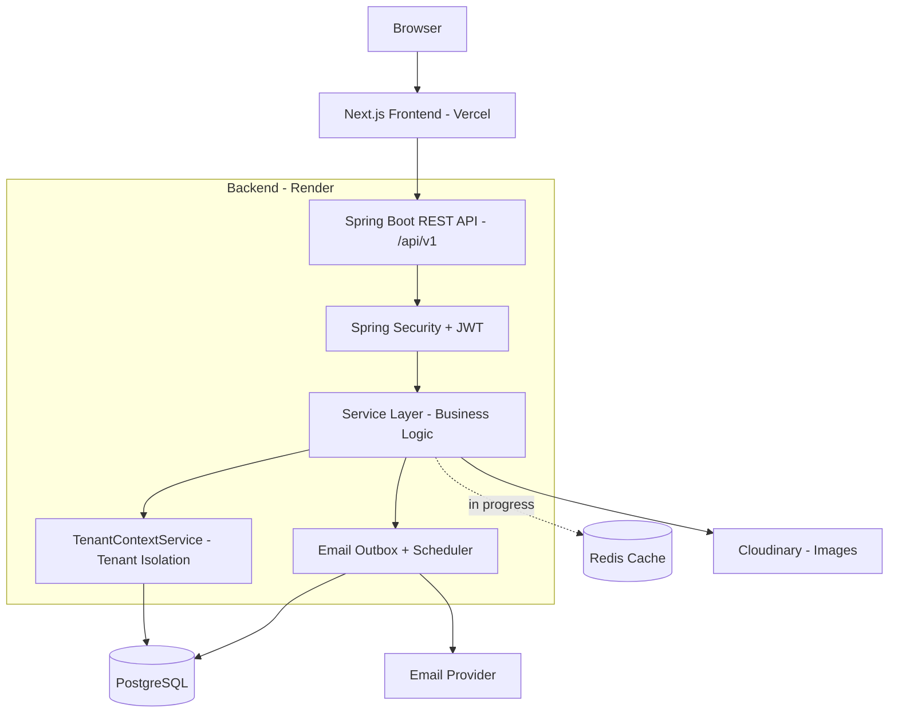
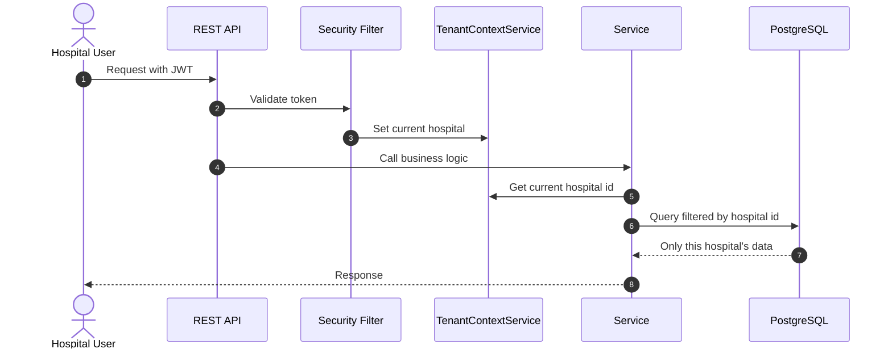
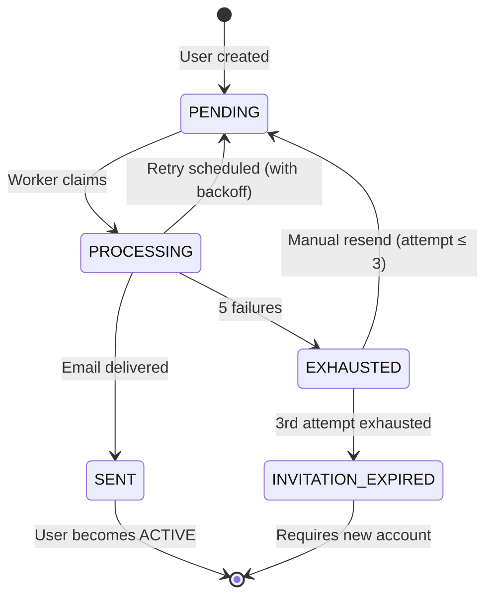
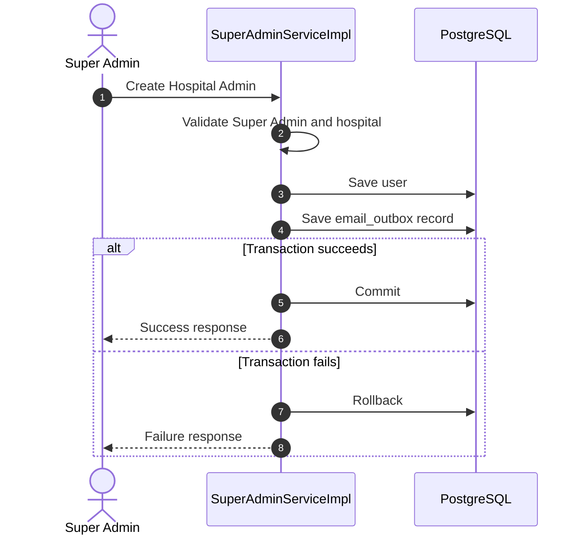

# MedCore — Multi-Tenant Hospital Management System

MedCore is a full-stack Hospital Management System where many hospitals run on **one deployment**, but each hospital's data stays **completely separate**. Built with Spring Boot and Next.js.

I did not build this only to make CRUD APIs work. My goal was to understand what happens in a real backend: data isolation, transactions, retries, duplicate requests, indexing, and failures. Every important concept I learned is written in my docs folder (links below).

**Live Demo:** https://medcore-hms-eight.vercel.app
**Backend API:** https://medcore-backend-jbgq.onrender.com

---

## Why this project is different

Most hospital projects are single-hospital CRUD apps. In MedCore, the main problem is:

> Doctor of Hospital A must never see a patient of Hospital B — even if a developer makes a mistake in one place.

So multi-tenant isolation is part of the design from day one, not added later. On top of that, I worked on the problems that usually come in production: what if email server is down, what if user clicks a button twice, what if two requests come at the same time.

---

## Roles

| Role | What they do |
|---|---|
| Super Admin | Creates hospitals and hospital admins across the platform |
| Hospital Admin | Manages one hospital: staff, departments, patients, billing |
| Doctor | Appointments, schedules, medical records, prescriptions |
| Nurse | Assigned patients, vitals, medication rounds |
| Receptionist | Walk-in registration, appointments, queue |
| Accountant | Billing, payments, financial reports |
| Patient | Book appointments, see prescriptions, reports, bills |

Access is checked in the backend, not only hidden in the UI.

---

## Features

The project is **feature-based** (each module has its own controller, service, repository, DTOs), so every module can be understood on its own.

- Authentication with JWT and refresh token rotation
- Hospital and Super Admin management
- Doctor management with schedules
- Patient management
- Appointment booking
- Medical records
- Prescriptions
- Pharmacy dispensing and inventory
- Billing and payments
- Lab orders and results
- Nurse, Receptionist and Accountant modules

---

## Architecture



### Multi-tenant isolation flow



Isolation is protected in layers: the current hospital comes from the authenticated request, services read it from `TenantContextService`, and repository queries are always scoped by hospital. Nothing is hard-deleted either — soft delete (`deletedAt`) is used everywhere.

### Email Outbox lifecycle



### Create Hospital Admin — transaction flow



---

## Backend concepts I worked on

These are the harder backend topics I implemented and wrote notes about. Each one has a doc in `backend/docs`.

| Concept | What I did | Doc |
|---|---|---|
| **Reliable Email Delivery** | Outbox pattern, retry, exponential backoff, jitter, `FOR UPDATE SKIP LOCKED`, stale processing recovery | [email-delivery.md](https://github.com/dulal-jgec/medcore-hms/blob/main/backend/docs/email-delivery.md) |
| **Idempotency** | `Idempotency-Key` header on resend API; duplicate request is blocked by a DB unique key with `ON CONFLICT DO NOTHING` (no race condition) | [invitation-and-idempotency.md](https://github.com/dulal-jgec/medcore-hms/blob/main/backend/docs/invitation-and-idempotency.md) |
| **Database Indexing** | Checked existing indexes, foreign keys, used `EXPLAIN` / `EXPLAIN ANALYZE`, added partial and composite indexes only where queries needed them, via Flyway migration | [database-indexing.md](https://github.com/dulal-jgec/medcore-hms/blob/main/backend/docs/database-indexing.md) |
| **Transaction Management** | `@Transactional` so user and email outbox are saved together or rolled back together | [transaction-management-and-consistency.md](https://github.com/dulal-jgec/medcore-hms/blob/main/backend/docs/transaction-management-and-consistency.md) |
| **Transaction Isolation** | Tested `READ COMMITTED` vs `REPEATABLE READ` with two PostgreSQL sessions | [transaction-isolation.md](https://github.com/dulal-jgec/medcore-hms/blob/main/backend/docs/transaction-isolation.md) |
| **Rollback Testing** | Integration test that forces outbox save to fail and checks the user is not saved | [transaction-rollback.md](https://github.com/dulal-jgec/medcore-hms/blob/main/backend/docs/transaction-rollback.md) |
| **N+1 Query Problem** | Used `@EntityGraph` / `JOIN FETCH` so list APIs load related data in one query, and checked SQL logs | in code (repositories) |

### Short notes on the important ones

**Email Outbox + Retry**
Sending email inside the API request is risky, because the SMTP server can fail. So the user and an `email_outbox` row are saved in one transaction, and a scheduled worker sends the email later. Failed email retries after 1, 2, 4, 8 minutes (plus a small random jitter so all retries don't hit at the same second). After 5 failures it becomes `EXHAUSTED`, and the Super Admin can resend — maximum 3 invitation attempts.

**Idempotency**
If the same resend request comes twice (double click, network retry), only one is accepted. I did not use "check if exists, then insert", because two requests can pass the check together. The database unique constraint decides the winner.

**Indexing**
A foreign key does not create an index automatically in PostgreSQL. I did not index every column, because indexes cost storage and slow down writes. I checked real query patterns first.

**Honest limitation:** external email delivery cannot be truly "exactly once". If the app crashes after SMTP accepts the mail but before the status is saved, the email can go twice. My design focuses on safe retries and no duplicate API effects, not on pretending this problem does not exist.

---

## Tech Stack

**Backend:** Java 21, Spring Boot 3, Spring Security, JWT, Spring Data JPA / Hibernate, PostgreSQL, Flyway, Spring Mail, Cloudinary, Docker, Nginx, CI/CD

**Frontend:** Next.js (App Router), React, Tailwind CSS, shadcn/ui, Zustand, React Hook Form, Zod

**Hosting:** Frontend on Vercel, backend and PostgreSQL on Render

---

## Testing

Backend tests use JUnit 5, Mockito and a separate PostgreSQL test database. The most important ones are the transaction tests:

| Test | What it checks |
|---|---|
| `SuperAdminTransactionIntegrationTest` | Transaction rollback works |
| `SuperAdminTransactionRollbackTest` | User is rolled back when outbox save fails |
| `SuperAdminTransactionSuccessTest` | User and outbox are both saved on success |
| `SuperAdminConcurrentRequestTest` | Concurrent requests with same email are blocked |

Run tests:

```bash
cd backend
./mvnw test
```

---

## Run Locally

**Requirements:** Java 21, Node.js 20+, PostgreSQL

**Backend**

```bash
cd backend
cp .env.example .env     # fill database, JWT, mail and Cloudinary values
./mvnw spring-boot:run
```

Flyway runs the database migrations automatically on startup.

**Frontend**

```bash
cd frontend
cp .env.example .env.local
npm install
npm run dev
```

Open `http://localhost:3000`.

---

## What I am learning now

I learn backend concepts daily and try to use them in this project. Right now I am working on **caching with Redis** — where to cache, how to invalidate, and how to keep cache and database consistent.

Next on my list:

- Distributed locking
- Message queues (RabbitMQ / Kafka)
- Better observability (metrics, tracing)
- Advanced indexing for reports

I write notes for each topic in [`backend/docs`](https://github.com/dulal-jgec/medcore-hms/tree/main/backend/docs), so I can come back to them later.

---

## More docs

Module-wise design notes are also in [`backend/docs`](https://github.com/dulal-jgec/medcore-hms/tree/main/backend/docs): database design, authentication, hospital, doctor, patient, appointment, medical record, prescription, pharmacy, billing, nurse, lab, receptionist, accountant and super admin.

---

## Author

**SK Dulal Islam** — Java / Full-Stack Developer, B.Tech IT (JGEC, 2027)

- GitHub: [dulal-jgec](https://github.com/dulal-jgec)
- LinkedIn: [sk-dulal-islam](https://www.linkedin.com/in/sk-dulal-islam-4b02542b2)
