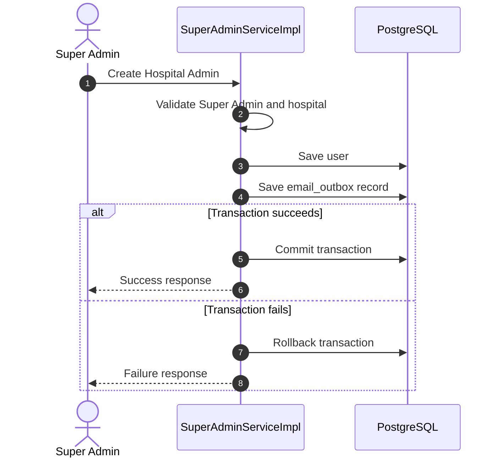

# Transaction Management in MedCore

## 1. Overview

In MedCore, creating a Hospital Admin requires saving a user and creating an email outbox record for the invitation.

I used Spring Boot's `@Transactional` annotation to handle both operations within the same database transaction.

## 2. Transaction Flow

## 3. Integration Tests

| Test class | Purpose |
|---|---|
| `SuperAdminTransactionIntegrationTest` | Verify transaction rollback |
| `SuperAdminTransactionRollbackTest` | Verify user rollback when email outbox saving fails |
| `SuperAdminTransactionSuccessTest` | Verify successful user and email outbox persistence |
| `SuperAdminConcurrentRequestTest` | Verify duplicate prevention for concurrent requests using the same email |

**Result:** All four tests passed in the reported test runs.

## 4. What I Learned

- How `@Transactional` manages related database operations.
- How rollback prevents partial database changes.
- How to verify transaction behavior through integration tests.
- Why database constraints are important when handling concurrent requests.
